# Slide kit: profiling project
Source text: `profiling_project_summary.md` (copy, same folder). Every image is a real figure from the project, copied unchanged into `images/`.
Figure numbers `fNN` match `story/STORY.md`. `rNN` images come from `regressor_bench/figs/`.
Suggested use: one slide per figure. The **Look at** line is the point to say aloud. The **Why it matters** line is the takeaway. Section numbers refer to the summary file.
The grouping below is the author's suggestion, not a project document.

## 1. Starting point (summary section 3)

### Where we started: inherited data vs our first 50-repetition run
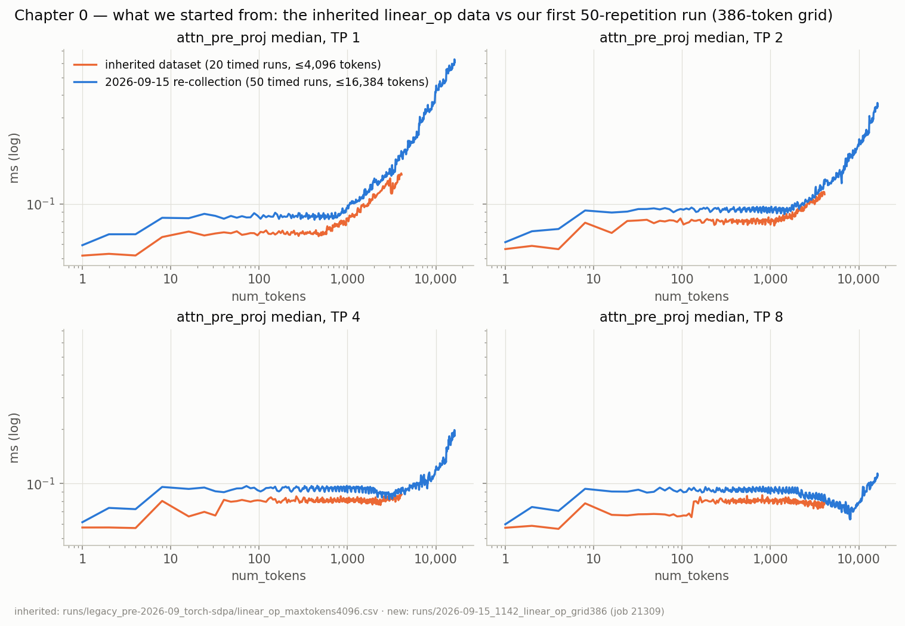
- **File:** `images/f00_baseline_inherited_vs_50rep.png`
- **Shows:** Median attn_pre_proj time against num_tokens, one panel per tensor-parallel degree (TP 1/2/4/8), both axes logarithmic. Orange is the dataset we inherited (20 timed runs per shape, token counts up to 4,096, aggregates only). Blue is our first re-collection on the profiler's default 386-token grid with 50 timed runs per shape (job 21309, 2026-09-15).
- **Look at:** Where both curves exist they lie on top of each other within noise; the blue curve continues to 16,384 tokens.
- **Why it matters:** This is the baseline. The re-collection reproduced the inherited medians, so nothing that follows is a disagreement about medians. Everything after this figure comes from the one thing the inherited data did not have: the individual timed runs, kept in execution order.

## 2. Data problems (section 4): the anomalies we saw

### The first anomaly: a 150–290 ms needle in one run of attn_pre_proj
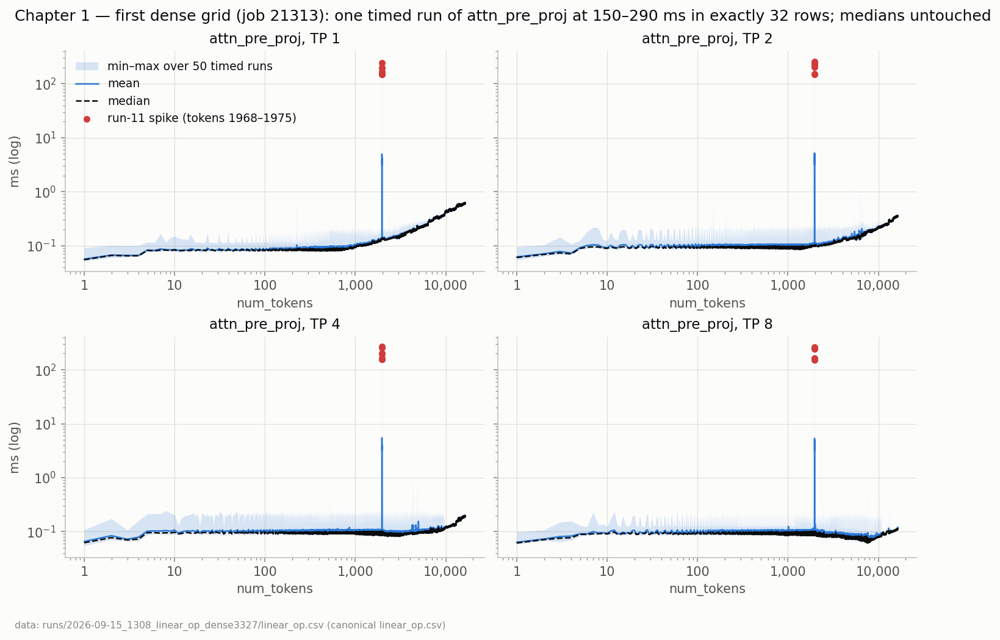
- **File:** `images/f01_spike_envelope_dense_original.png`
- **Shows:** The dense 3,327-token grid as first collected (job 21313). Per TP panel: the shaded band is the min–max range over the 50 timed runs of each shape, the solid line the mean, the dashed line the median. Red dots mark rows whose maximum sample exceeds 50 ms.
- **Look at:** A single needle near 1,970 tokens in every panel: the maximum and the mean jump three orders of magnitude while the median line does not move. Exactly 32 rows are affected (tokens 1968–1975 × 4 TPs).
- **Why it matters:** This is what we saw first. It is only visible because we plotted more than the median; a median-only dataset would have hidden it completely. It opened the garbage-collection investigation (chapters 1–4).

### One affected row, sample by sample
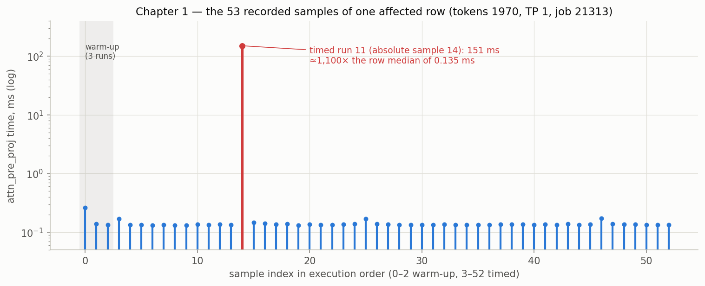
- **File:** `images/f02_spike_one_row_samples.png`
- **Shows:** All 53 recorded samples of a single row (tokens 1970, TP 1, job 21313) in execution order, log scale. The grey band covers the 3 warm-up runs; the red bar is timed run 11.
- **Look at:** Every sample sits at about 0.13 ms except one, at roughly 150 ms, about 1,100× the row median. It is not the first run, so it is not warm-up.
- **Why it matters:** It shows the anomaly is a single sample inside an otherwise flat series, which is why medians were untouched while mean and max were destroyed. Its fixed position, run 11, was the clue that eventually pointed away from the GPU.

### The spike reproduces exactly on another node, 17 hours later
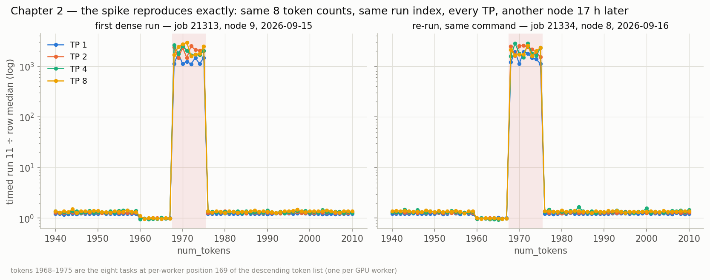
- **File:** `images/f03_spike_band_first_vs_rerun.png`
- **Shows:** Timed run 11 divided by the row median for tokens 1940–2010, one line per TP; left panel the first dense run (job 21313, node 9), right panel the byte-identical re-run (job 21334, node 8). The shaded band is tokens 1968–1975.
- **Look at:** The same eight consecutive token counts light up by about 1,000× in both panels, at every TP, and nothing else does.
- **Why it matters:** A 26-token repro earlier had failed to reproduce the spike, which suggested a one-off stall. This figure ruled that out: the event is deterministic and keyed to the position of a task inside a worker's history, not to the shape or the node. That is what justified building instrumentation instead of guessing.

### A second, subtler fingerprint at fixed run positions
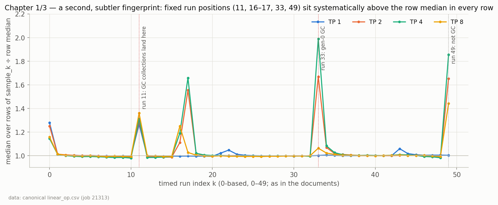
- **File:** `images/f04_run_position_fingerprint_original.png`
- **Shows:** For every row of the original dense grid, each timed sample divided by its row median; the plot is the median of that ratio across all rows, per timed run index (0-based, as in the investigation documents), one line per TP. Dotted lines mark runs 11, 33 and 49.
- **Look at:** The curve is flat at 1.0 except at fixed positions: run 11 is about 1.3× in every row, and runs 16–17, 33 and 49 are also raised. These are not outliers in a few rows; they are systematic across all 13,308 rows.
- **Why it matters:** The run-11 elevation is the cheap generation-0/1 garbage collections landing at the same place as the expensive full collection; it later became acceptance criterion 4 for the fix. The bumps at runs 0, 16 and 49 are not GC and survive the fix, as Fig. 9 shows.

### The second anomaly: a V-shaped dip that should not exist
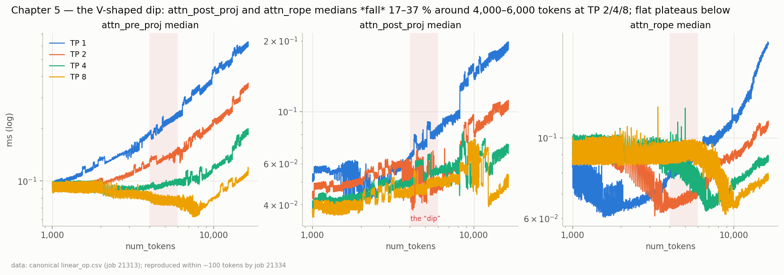
- **File:** `images/f09_dip_medians_original.png`
- **Shows:** Median time against num_tokens from 1,000 to 16,384 for attn_pre_proj, attn_post_proj and attn_rope in the original dense data, one line per TP, log scale. The shaded band is 4,000–6,000 tokens.
- **Look at:** At TP 2, 4 and 8 the attn_post_proj and attn_rope medians fall by 17–37 % inside the band and then climb back, and below it they are flat for thousands of tokens although the GEMM's M grows 100×. attn_pre_proj, timed in the same forwards, shows no V.
- **Why it matters:** This is the second thing that made no sense, reproduced within about 100 tokens by the independent re-run. It opened chapters 5–9: first a hunt for a GPU or library mechanism, then the discovery that the profiler was often measuring the host.

### The clue inside the dip: samples that are sometimes host, sometimes kernel
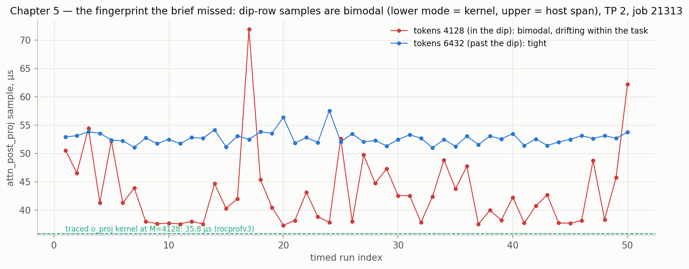
- **File:** `images/f10_dip_row_samples_bimodal.png`
- **Shows:** The 50 timed attn_post_proj samples of two rows at TP 2 in the original data: tokens 4128, inside the dip (red), and tokens 6432, past it (blue). The dashed line is the o_proj kernel duration at M = 4128 measured by rocprofv3 (35.8 µs).
- **Look at:** The dip row is bimodal and drifts within the task from about 50 µs down to about 38 µs, just above the traced kernel; the row past the dip is tight and stable.
- **Why it matters:** The lower mode is the kernel and the upper mode is the host's launch span. This was the observation that turned attention away from tile selection and toward the measurement itself.

## 3. Collection bug 1: garbage collection stall (section 5)

### The proof: the stall is a CPython full garbage collection
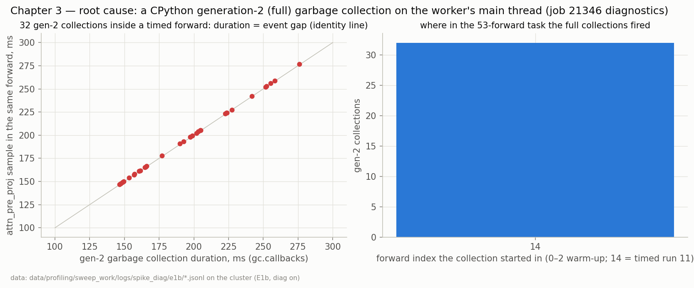
- **File:** `images/f05_gc_gen2_duration_vs_spike.png`
- **Shows:** From the instrumented run (job 21346, diagnostics recording every GC collection and the host window of every forward). Left: duration of each generation-2 collection against the attn_pre_proj sample recorded in the same forward, with the identity line. Right: the forward index in which those collections started.
- **Look at:** All 32 collections fall on the identity line, so the event gap equals the collection duration to within a millisecond. All of them started in forward 14, which is timed run 11.
- **Why it matters:** This closes the root cause. The CUDA-event pair measured a host stall while the GPU idled; no GPU, allocator or library effect is needed, and interventions on the interpreter's GC (collect, freeze, disable) moved or removed the spike as predicted.

### Why always run 11: the GC counter arithmetic
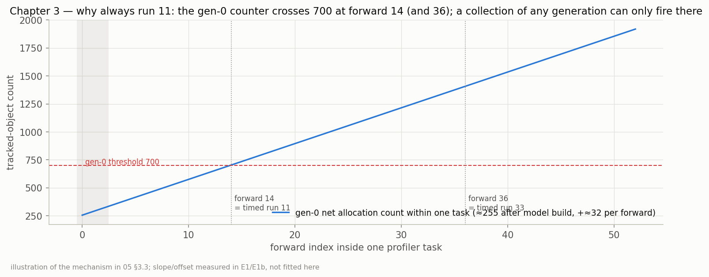
- **File:** `images/f06_gc_counter_model.png`
- **Shows:** An illustration of CPython's generation-0 allocation counter within one profiler task, using the slope and offset measured in the diagnostics: about 255 tracked allocations during model build, then about 32 per forward, against the threshold of 700.
- **Look at:** The counter crosses 700 at forward 14 (timed run 11) and again at forward 36 (run 33). A collection of any generation can only fire at those crossings; the expensive full collection fires at the first crossing after CPython's long-lived-object rule is met, once per pass.
- **Why it matters:** It explains the fixed position without invoking anything on the GPU: the same allocation sequence replays in every fresh worker process, so the same task index is hit in every TP pass.

### After the fix: the 150–290 ms class is gone
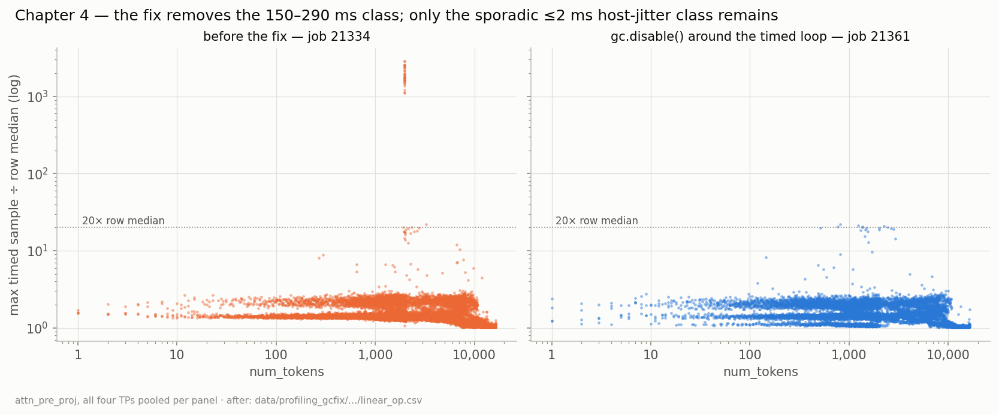
- **File:** `images/f07_gcfix_max_over_median_before_after.png`
- **Shows:** Per row, the maximum timed attn_pre_proj sample divided by the row median, all TPs pooled, log scale. Left: before the fix (re-run job 21334). Right: with gc.disable()/gc.enable() around the timed loop (job 21361). The dotted line is 20× the median.
- **Look at:** The cluster of points at about 1,000× near 1,970 tokens on the left has no counterpart on the right. What remains are sporadic points below about 20×, the separate host-jitter class that was never GC.
- **Why it matters:** Acceptance criteria 1 and 2 of the fix plan, checked on the full 13,308-row grid rather than on a small repro.

### After the fix: the run-position fingerprint
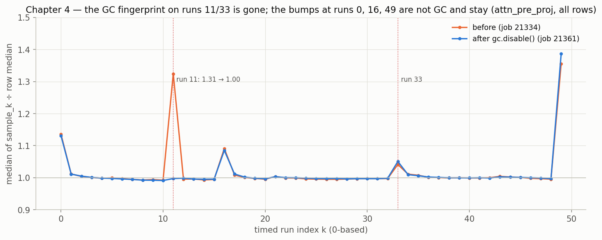
- **File:** `images/f08_fingerprint_before_after_gcfix.png`
- **Shows:** The same run-position profile as Fig. 4 (median across rows of sample ÷ row median, per timed run), before the fix in orange and after in blue, all rows pooled.
- **Look at:** Run 11 drops from 1.31 to 1.00 and run 33 flattens. The bumps at runs 0, 16 and 49 are unchanged.
- **Why it matters:** Acceptance criterion 4, and a clean separation of what was GC (gone) from what was not (still there). The remaining bumps became part of the later run-position investigation.

### The stall class is gone even with 200 samples per row
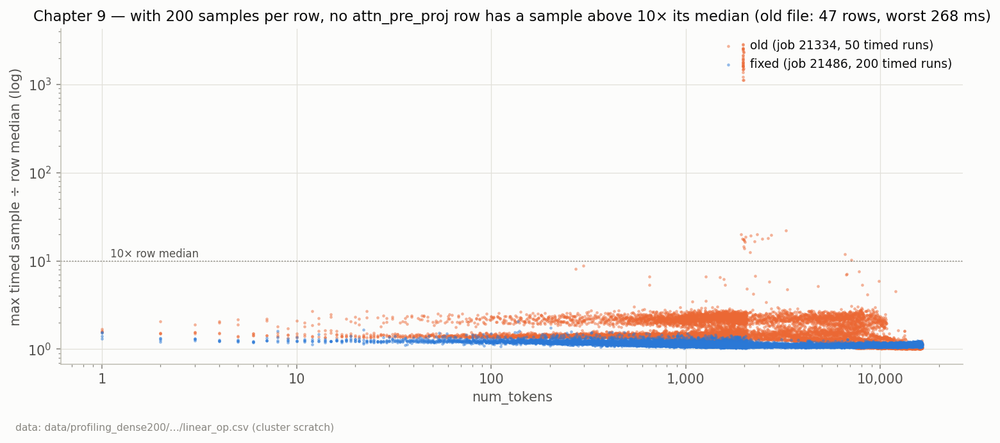
- **File:** `images/f22_stall_gone_200_reps.png`
- **Shows:** Per row, the maximum timed attn_pre_proj sample divided by the row median, log scale: the old data (orange, 50 timed runs, job 21334) against the fixed collection with 200 timed runs per shape (blue, job 21486). Dotted line at 10×.
- **Look at:** Orange has the 1,000× cluster near 1,970 tokens plus scattered points between 10× and 20×; blue never exceeds about 3× anywhere, despite four times as many samples per row.
- **Why it matters:** Final confirmation of the GC fix on the production-shaped dataset: the worst single sample in the whole file is 0.74 ms.

## 4. Host time versus GPU time (sections 5 and 8)

### One knob, no dip: keeping the device busy removes the artefact
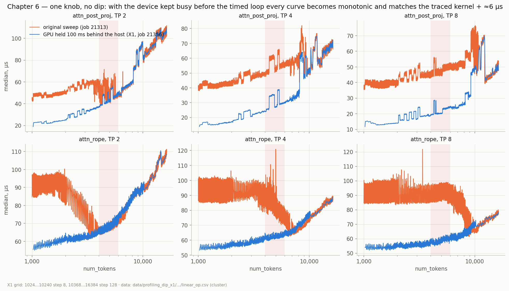
- **File:** `images/f11_dip_original_vs_gpu_backlog.png`
- **Shows:** Median attn_post_proj (top) and attn_rope (bottom) against num_tokens at TP 2, 4 and 8. Orange is the original sweep; blue is experiment X1 (job 21356), identical except that a 100 ms device spin was enqueued before each timed loop so the GPU runs behind the host.
- **Look at:** Blue rises monotonically everywhere and lies below orange until the two merge at high token counts. The dip and the plateaus exist only in orange. The steps in blue are real (hipBLASLt tile switches, see Fig. 14).
- **Why it matters:** A single change that does not touch the kernels made every curve monotonic. That is the decisive evidence that the event pairs had been measuring host launch time whenever the GPU was idle at the start event.

### The artefact was not confined to the dip band
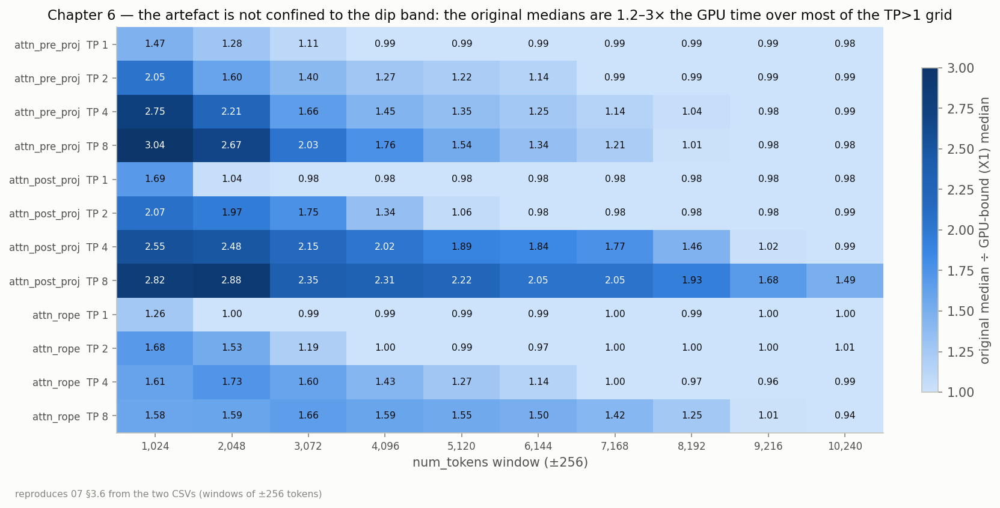
- **File:** `images/f12_inflation_original_over_gpu_bound.png`
- **Shows:** Heat map of original median divided by GPU-bound (X1) median, by operator × TP (rows) and num_tokens window (columns). Darker means more inflated.
- **Look at:** Values of 1.2–3× over most of the TP>1 grid up to 8,000–10,000 tokens, and at TP 1 below 2,000–3,000 tokens. attn_pre_proj, which the dip brief had used as its clean negative control, is inflated as well; it simply has no V because nothing is queued in front of it.
- **Why it matters:** This quantifies how much of the canonical dataset was host time rather than GPU time, and is the reason a re-collection was needed rather than a patch to a band of rows.

### The GPU truth: the o_proj kernel is monotonic, with one slow tile band
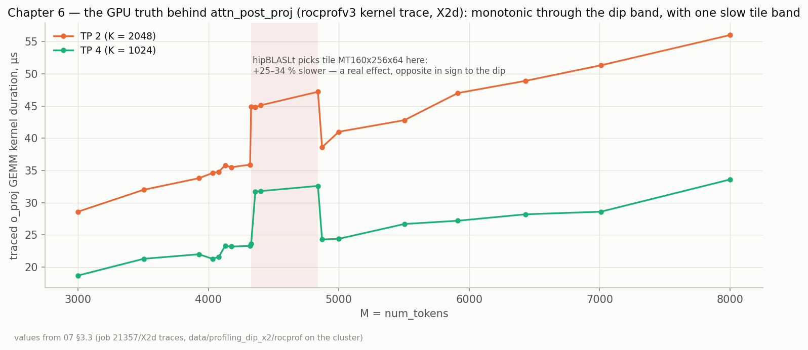
- **File:** `images/f13_oproj_kernel_trace_tiles.png`
- **Shows:** Duration of the traced o_proj GEMM kernel (rocprofv3, single worker) against M = num_tokens at TP 2 and TP 4. The shaded band is M ≈ 4328–4840.
- **Look at:** The kernel grows monotonically through the whole dip band. Inside the shaded band hipBLASLt picks the MT160x256x64 tile and the kernel is 25–34 % slower, then it steps back down.
- **Why it matters:** It refutes the brief's leading candidate (a faster kernel chosen in the dip band: there is none) and at the same time records a real effect in the opposite direction that the fixed data still shows as steps (Fig. 21). The dip could not have come from the kernel.

### The fix made visible on the pre-registered validation grid
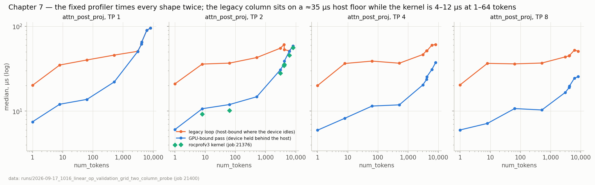
- **File:** `images/f14_validation_grid_two_columns.png`
- **Shows:** attn_post_proj median at the eight pre-registered token counts, one panel per TP, from the fixed profiler (job 21400). Orange is the legacy timing loop; blue is the new GPU-bound pass in which the device is held behind the host. Aqua diamonds on the TP 2 panel are the rocprofv3 kernel durations of the same shapes.
- **Look at:** Orange sits on a floor of about 35 µs from 1 to 512 tokens regardless of work; blue follows the kernel down to about 6 µs and matches the aqua points to within a few microseconds. The two columns merge where the legacy loop was already GPU-bound.
- **Why it matters:** This is the two-column fix: every shape is now timed both ways, so the host-bound regime is documented rather than silently mixed into the kernel numbers. The validation grid was chosen and its expected values written down before this run.

### Warm-up does not warm the clock
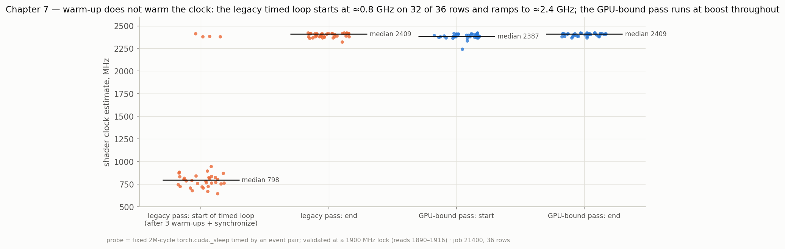
- **File:** `images/f15_clock_probe_per_pass.png`
- **Shows:** The per-row shader-clock estimate (a fixed 2M-cycle device spin timed by an event pair) at four points of each task in the validation grid: start and end of the legacy timed loop, and start and end of the GPU-bound loop. One dot per row, black bar at the median.
- **Look at:** The legacy loop starts at a median of about 800 MHz on 32 of 36 rows, even after three warm-up forwards and a synchronize, and ends near 2,400 MHz. The GPU-bound loop runs near 2,400 MHz throughout.
- **Why it matters:** The two timing columns therefore differ by clock state as well as by queue state. This finding put a clock probe on every row of every later collection and made 'at a stated clock condition' part of the measurement contract.

## 5. Silent kernel selection: RoPE (section 6)

### RoPE was never RoPE: fallback vs the fused kernel
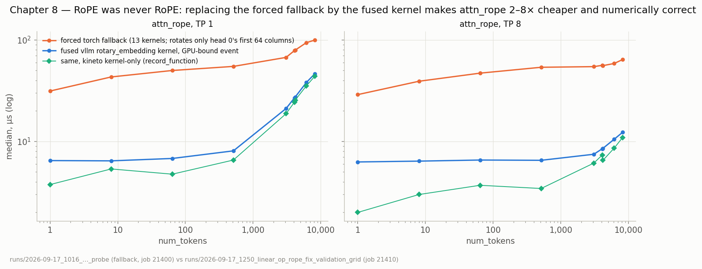
- **File:** `images/f16_rope_fallback_vs_fused.png`
- **Shows:** attn_rope median against num_tokens at TP 1 and TP 8, log scale. Orange is the forced torch fallback that every earlier run had timed (13 kernels; it rotated only the first 64 columns of head 0). Blue is the fused vLLM rotary_embedding kernel measured with the GPU-bound event pair; aqua is the same kernel measured kernel-only with kineto.
- **Look at:** The fused kernel is 2–8× cheaper across the grid, and the event-pair value sits a constant 2.5–3 µs above the kernel-only value, the per-scope record cost.
- **Why it matters:** The old attn_rope column measured a computation that was not RoPE. After this fix every row records which implementation it timed, and the checker rejects anything but the fused kernel.

## 6. Old data versus fixed data (sections 4 and 8)

### The re-collected dense grid, both columns on every row
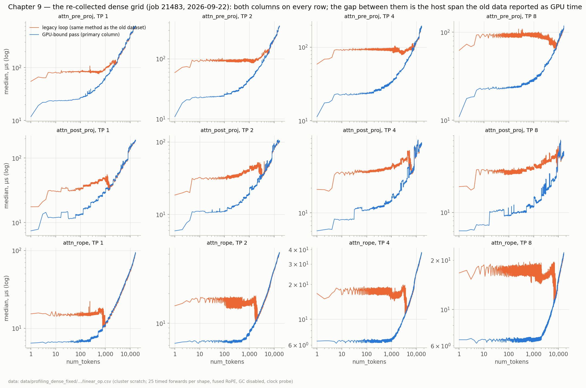
- **File:** `images/f17_dense_fixed_gpu_bound_vs_legacy.png`
- **Shows:** The 2026-09-22 dense collection with every fix active (job 21483): median against num_tokens for attn_pre_proj, attn_post_proj and attn_rope at each TP, log-log. Orange is the legacy column (same method as the old dataset), blue the GPU-bound column that is now the primary one.
- **Look at:** Orange sits on a host floor of 35–100 µs until the kernel outgrows it; blue rises smoothly from 6–10 µs. The vertical gap between them is exactly what the old dataset reported as GPU time.
- **Why it matters:** This is the dataset the story was working toward: monotonic kernel-time curves with the host-bound regime recorded beside them instead of hidden inside them.

### The dip is gone
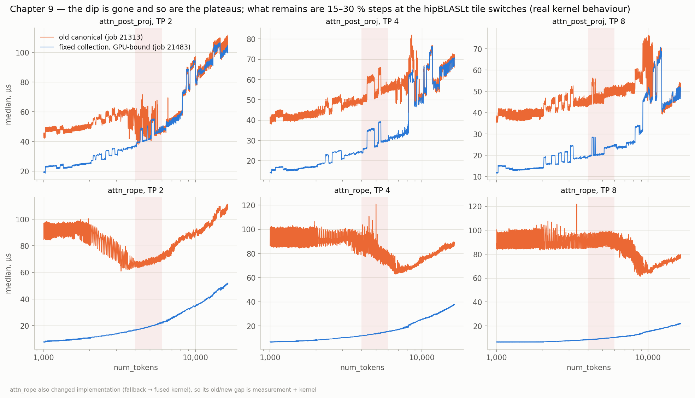
- **File:** `images/f18_dip_gone_old_vs_fixed.png`
- **Shows:** attn_post_proj (top) and attn_rope (bottom) medians from 1,000 to 16,384 tokens at TP 2, 4 and 8: the old canonical file (orange, job 21313) against the fixed GPU-bound column (blue, job 21483). Shaded band as before.
- **Look at:** No V and no plateau anywhere in blue; costs rise with tokens as a GEMM should. The remaining 15–30 % steps are the hipBLASLt tile switches (Fig. 21). attn_rope is far lower because it also changed from the wrong fallback to the fused kernel.
- **Why it matters:** The 'after' picture for chapters 5–8: the anomaly that started the investigation does not exist in the corrected measurement.

### How inflated the old data was, shape by shape
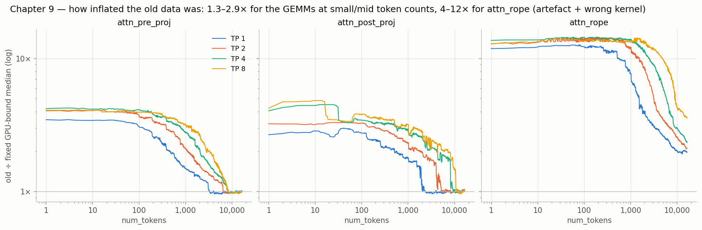
- **File:** `images/f19_old_over_fixed_ratio.png`
- **Shows:** Old median divided by fixed GPU-bound median against num_tokens for the three attention ops, one line per TP (rolling median over 15 shapes), log scale.
- **Look at:** GEMMs: 1.3–3× at small and mid token counts, converging to 1 where the legacy loop was already GPU-bound. attn_rope: 4–12× across the grid, the artefact and the wrong kernel combined.
- **Why it matters:** This is what a cost model trained on the old file would have learned wrongly: a per-op cost that changes kind with shape (host span at small M, kernel at large M) rather than the hardware's behaviour.

### What remains is real: tile-selection steps
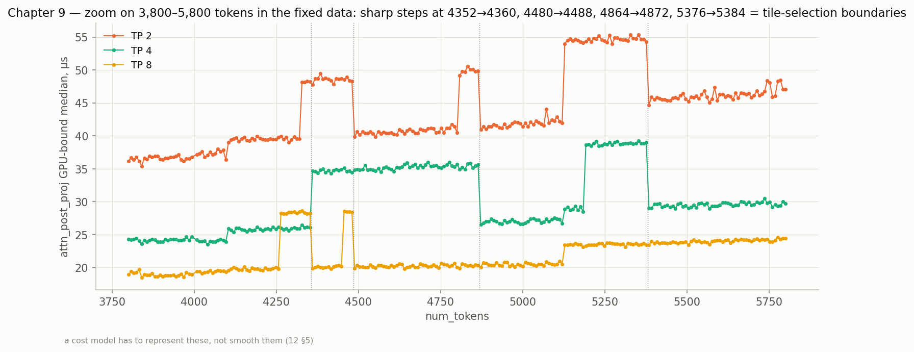
- **File:** `images/f20_tile_steps_zoom_fixed.png`
- **Shows:** attn_post_proj GPU-bound median between 3,800 and 5,800 tokens at TP 2, 4 and 8 in the fixed collection; dotted lines at 4360, 4488, 4872 and 5384.
- **Look at:** Sharp steps of 15–30 % at those token counts, consistent across the TPs.
- **Why it matters:** These are hipBLASLt choosing a different tile for the GEMM, confirmed in the kernel traces. A cost model has to represent them; smoothing them away would be a new error. They are also why 'monotonic' was never used as a validation criterion.

### Collection diagnostics recorded on every row
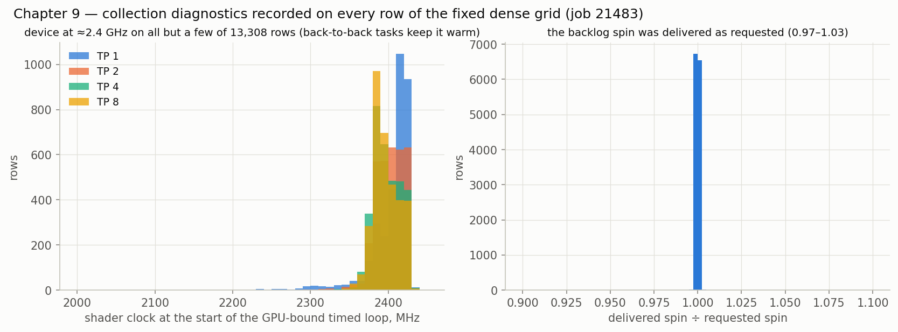
- **File:** `images/f21_collection_diagnostics_fixed.png`
- **Shows:** Left: histogram of the shader-clock probe at the start of the GPU-bound loop, by TP, for all 13,308 rows of job 21483. Right: histogram of the delivered device spin divided by the requested spin.
- **Look at:** The clock is at or above 2.2 GHz on all but a handful of rows because back-to-back tasks keep the device warm; the spin was delivered within 3 % of the request everywhere.
- **Why it matters:** The measurement contract requires the clock condition and the GPU-bound condition to be stated, not assumed. These two columns show they held across the whole grid.

## 7. Run-position effects: spin backlog and ROCm barrier (section 5, bugs 4 and 5)

### The third anomaly: two patterns tied to run position
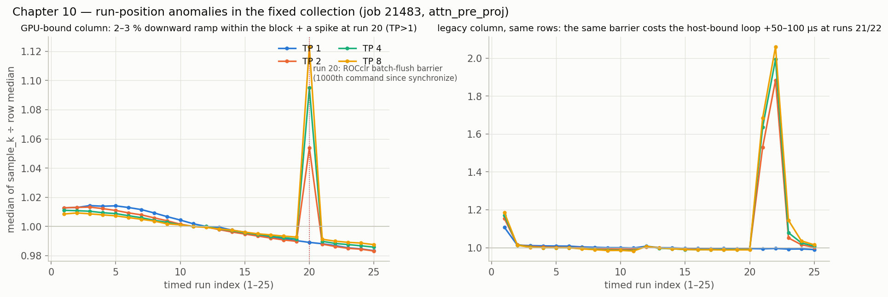
- **File:** `images/f23_position_profile_fixed_25.png`
- **Shows:** Run-position profile of attn_pre_proj in the fixed 25-forward collection (job 21483): the median across rows of sample ÷ row median at each timed run 1–25, one line per TP. Left: the GPU-bound column. Right: the legacy column of the same rows.
- **Look at:** Left: a smooth 2–3 % decline from run 3 to run 25, plus a sharp spike at run 20 for TP>1 only. Right: the same rows show a +50–100 % stall at runs 21 and 22 in the legacy loop.
- **Why it matters:** Two separate mechanisms hidden in otherwise clean data, only visible because per-run samples are kept. Chapter 10 traces them to the backlog spin (the ramp) and to the ROCm runtime's batch-flush barrier (the spike and the stall).

### 200 repetitions confirm the packet-count prediction
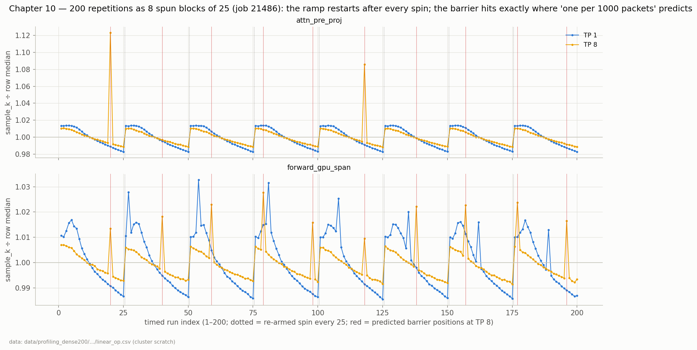
- **File:** `images/f24_position_profile_200_reps.png`
- **Shows:** The same run-position profile as Fig. 24, over 200 timed runs collected as 8 spun blocks of 25 (job 21486), for attn_pre_proj and the whole-forward span, at TP 1 and TP 8. Dotted lines mark where the device spin is re-armed; red lines are the positions where 'one barrier per 1000 commands since the last synchronize' predicts a hit at TP 8.
- **Look at:** The downward ramp restarts after every spin, in every block. The spikes fall exactly on the predicted positions 20, 40, 59, 79, 98, 118, 138, 157, 177, 196.
- **Why it matters:** A mechanism that predicts ten positions in advance is confirmed, not fitted. It also shows the ramp is a property of the spin, since it resets with it.

### Fix for the barrier, verified
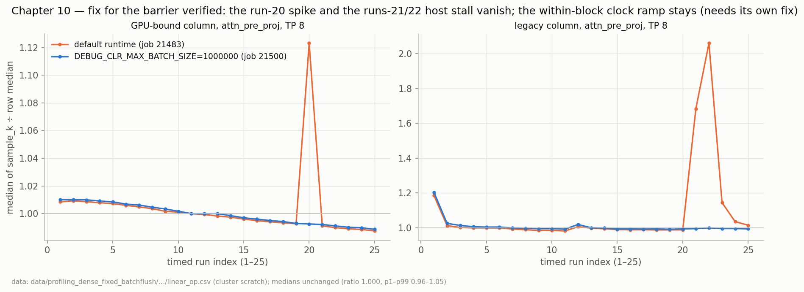
- **File:** `images/f25_batchflush_before_after.png`
- **Shows:** attn_pre_proj run-position profiles at TP 8 with the default ROCm runtime (orange, job 21483) versus the same collection with DEBUG_CLR_MAX_BATCH_SIZE=1000000 in the container (blue, job 21500). Left: GPU-bound column. Right: legacy column.
- **Look at:** The run-20 spike and the runs-21/22 stall are gone with the flag; the within-block ramp is unchanged. Medians agree between the two runs to 1.000.
- **Why it matters:** The runtime's clean-up marker after every 1000 commands no longer lands inside a timed loop. This closes the second run-position effect; the first (the ramp) still needs its own fix.

### Root cause of the ramp: the spin lets the clocks idle
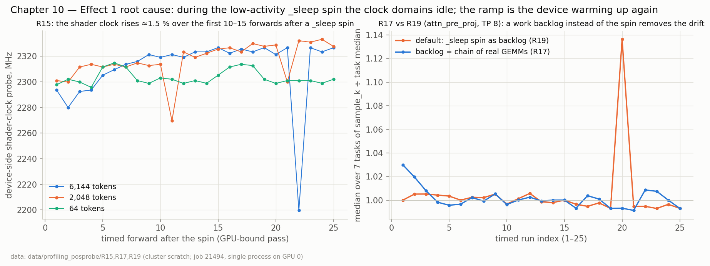
- **File:** `images/f26_clock_ramp_after_spin.png`
- **Shows:** Single-process probes (job 21494). Left: a device-side shader-clock reading after each of the 25 timed forwards following the backlog spin, for three token counts. Right: the attn_pre_proj run-position profile at TP 8 with the default _sleep spin as backlog (orange) versus an equal-length chain of real GEMMs as backlog (blue).
- **Look at:** Left: the shader clock climbs about 1.5 % over the first 10–15 forwards after a spin. Right: with a work backlog instead of the spin the profile is flat; the drift is gone. (The orange spike at run 20 is the batch-flush barrier of Fig. 27.)
- **Why it matters:** The low-activity spin lets the device's clock domains drop, and the first forwards of every block run while they ramp back up. The fix, a work backlog or a few untimed forwards after the spin, is proposed but not yet run.

### Effect 1 on the dense grid: spin vs work backlog vs work backlog with 8 settle forwards
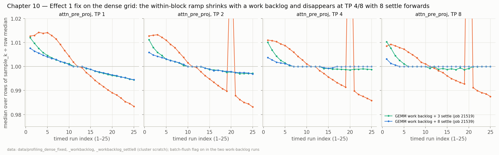
- **File:** `images/f27_settle_position_profiles.png`
- **Shows:** Run-position profile of attn_pre_proj (median across rows of sample ÷ row median at each timed run 1–25), one panel per TP, for three full dense collections: the _sleep spin backlog (orange, job 21483), the allocating GEMM backlog with 3 settle forwards (aqua, job 21519) and the same with 8 settle forwards (blue, job 21539). The orange run-20 spike is the batch-flush barrier of Figs. 24, 25 and 27; it is off the vertical scale here on purpose.
- **Look at:** Orange ramps down 2–3 % over the block at every TP. Aqua halves the ramp and leaves a 1 % transient in runs 1–4. Blue is flat to ±0.1 % from run 1 at TP 4 and TP 8; at TP 1 and TP 2 a slow, linear 1 % decline over the block remains, identical with 3 and 8 settle forwards.
- **Why it matters:** The fix verified on the production-shaped 8-GPU collection rather than on a single-GPU probe. The residual at TP 1/2 does not depend on the settle count and is absent in single-GPU runs, so it is attributed, speculatively, to clock or thermal settling under full-node load on a timescale longer than a block. Medians are affected by less than 0.5 %.

### What the ramp had cost the medians
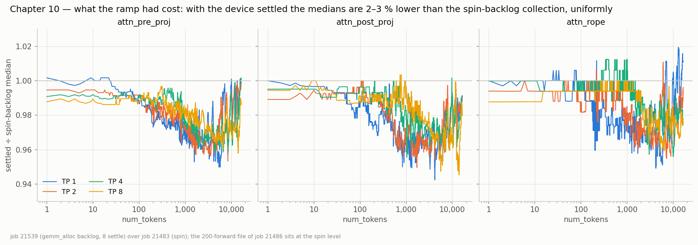
- **File:** `images/f28_settled_vs_spin_medians.png`
- **Shows:** Median of the settled-clock collection (job 21539) divided by the median of the spin-backlog collection (job 21483), per op and TP, against num_tokens (rolling median over 25 shapes).
- **Look at:** Below 1.0 nearly everywhere: the GEMMs are 2–3 % lower with the device settled, RoPE about 1.5 %, and the effect is uniform across TP. The 200-forward file of job 21486, staged the day before as canonical, sits at the spin level.
- **Why it matters:** It quantifies the bias the within-block ramp had put into the medians of every spin-backlog collection: the medians of those files were taken mid-ramp. This is why the handoff points at job 21539 and not at the 200-forward file, and why anyone comparing models fitted on both should expect this offset.

### The Effect 1 fix campaign: settling after the spin changes nothing, a work backlog does
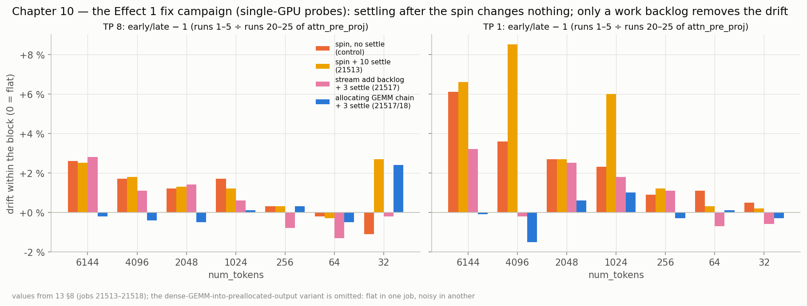
- **File:** `images/f29_effect1_fix_variants.png`
- **Shows:** Single-GPU probe runs (jobs 21513–21518), attn_pre_proj, 25 timed forwards, seven token counts. Each bar is the within-block drift, the median of runs 1–5 divided by the median of runs 20–25 minus one, so 0 means a flat block. Orange is the control (the _sleep spin, no settle); yellow adds 10 untimed forwards after the spin; magenta replaces the spin by a memory-streaming add over 1 GB operands plus 3 settle forwards; blue replaces it by an allocating chain of 4096² GEMMs plus 3 settle forwards. Left TP 8, right TP 1.
- **Look at:** The yellow bars are as tall as the orange ones or taller: waiting after the spin does not help, because the clock does not start rising until load begins. The magenta bars are flat at TP 8 but still drift at the heavy TP 1 shapes. Only the blue bars sit at zero at both TPs.
- **Why it matters:** This is the search for the Effect 1 fix, including what did not work. It ruled out the cheap option (settle only) and selected the allocating GEMM chain as the backlog, which became the profiler default (backlog_kind = gemm_alloc).

## 8. Final dataset for the regressor (section 9)

### The dataset handed to the regressor
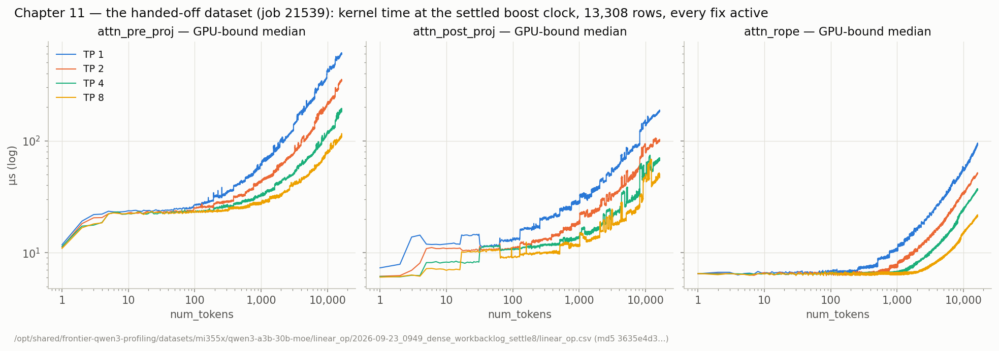
- **File:** `images/f30_final_dataset_medians.png`
- **Shows:** GPU-bound medians of the three attention ops against num_tokens, one line per TP, from the final collection (job 21539, 2026-09-23): 13,308 rows, two timing columns, fused RoPE, GC disabled, allocating GEMM backlog, 8 settle forwards, batch-flush flag, clock probe on every row. Stored under the shared datasets store with a README and SHA256SUMS.
- **Look at:** Every op is flat at small token counts (weight-read or fixed-cost bound), then grows roughly linearly, with the hipBLASLt tile steps at TP 2/4/8 kept as they are. No dip, no plateau, no spike class.
- **Why it matters:** This is where the story ends for now: the label is time_stats.<op>.median in milliseconds, kernel time at the settled boost clock plus a constant per-scope record cost, with the measurement contract defining what it means. The handoff document (14_) describes features, label, caveats and the re-check commands.

## 9. Regressor result (section 9)

### Regressor leaderboard, random split
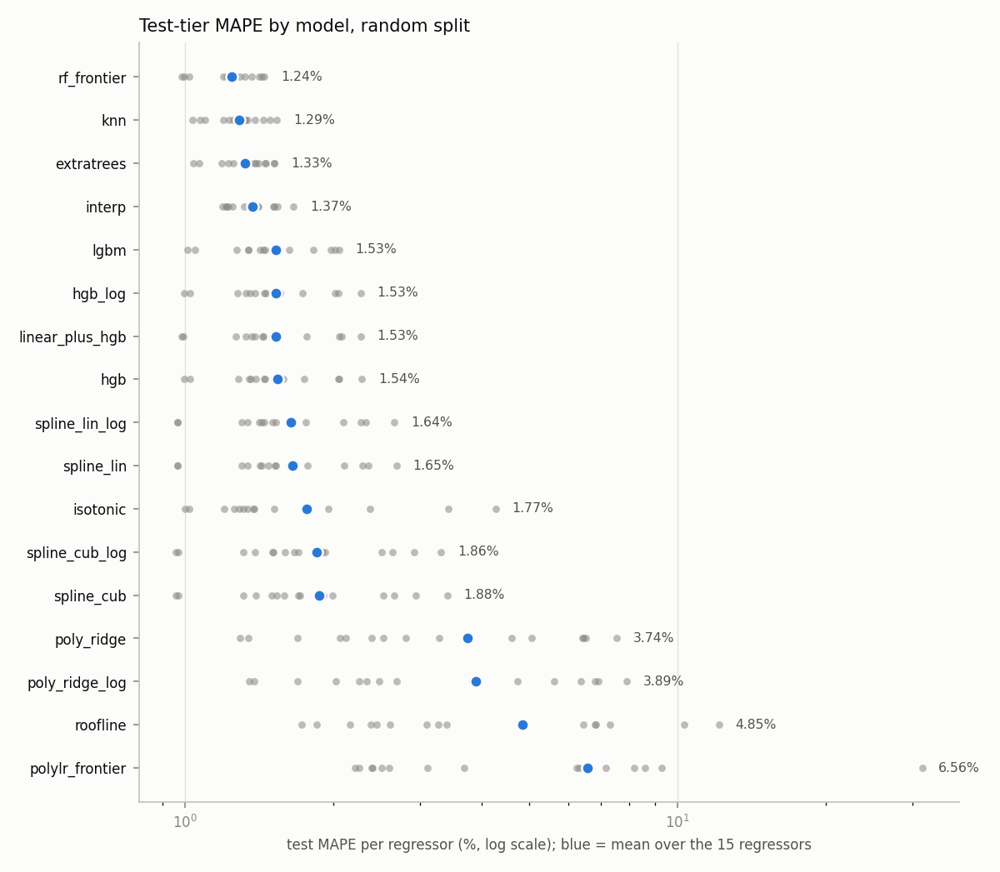
- **File:** `images/r01_regressor_leaderboard_random_split.png` (same image as `regressor_bench/results/full_v1/figs/leaderboard_random.png`)
- **Shows:** test-tier MAPE of 16 regressor models on the random split. Grey dots are the 15 individual regressors. The blue dot is the mean. The axis is logarithmic.
- **Look at:** the best models (`rf_frontier` 1.24 percent, `knn` 1.29, `extratrees` 1.33, `interp` 1.37) sit close together. The polynomial and roofline models are 3 to 6.6 percent.
- **Why it matters:** a regressor can learn the data. The choice among the top models is a small difference. This is the `full_v1` run. The summary table (section 9) uses the `baseline_v2` run, which has three models and gives `rf` 1.25 percent. The numbers differ by a little because the runs differ.

### Regressor leaderboard, block split
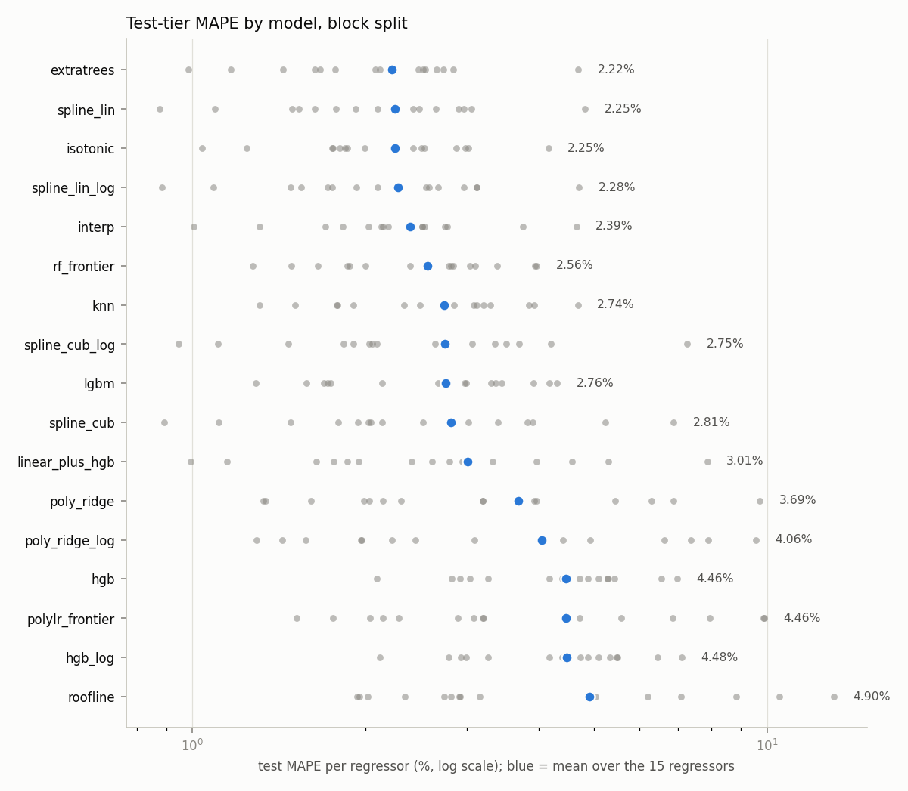
- **File:** `images/r02_regressor_leaderboard_block_split.png` (same image as `regressor_bench/results/full_v1/figs/leaderboard_block.png`)
- **Shows:** the same 16 models on the block split. This split holds out whole blocks of token values, so it is harder.
- **Look at:** every model is worse than on the random split. `rf_frontier` is 2.56 percent and `extratrees` is best at 2.22 percent. The order changes.
- **Why it matters:** the random-split result is the optimistic case. The summary (section 9) also gives the mean P95 of `rf_frontier` on the block split: 9.04 percent. That is a different metric from the MAPE in this figure.

## Phases without a project figure

No real figure exists for these. Use the tables in the summary file.
- Phase 5, model choice (section 7)
- Phase 8, Dataset B (section 10)
- Phase 9, operator-definition mismatch (section 11): the verdict table
- Phase 10, decisions D1 to D5 (section 12)

The captions for `r01` and `r02` were written for this kit by reading the images. Figures `f00` to `f30` use the captions in `story/captions.json`.
