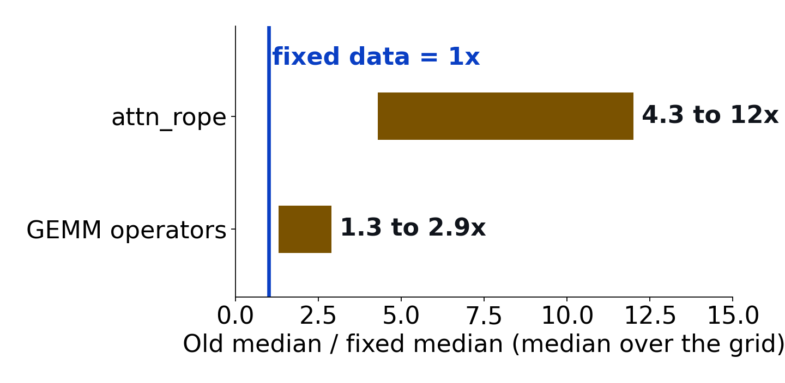
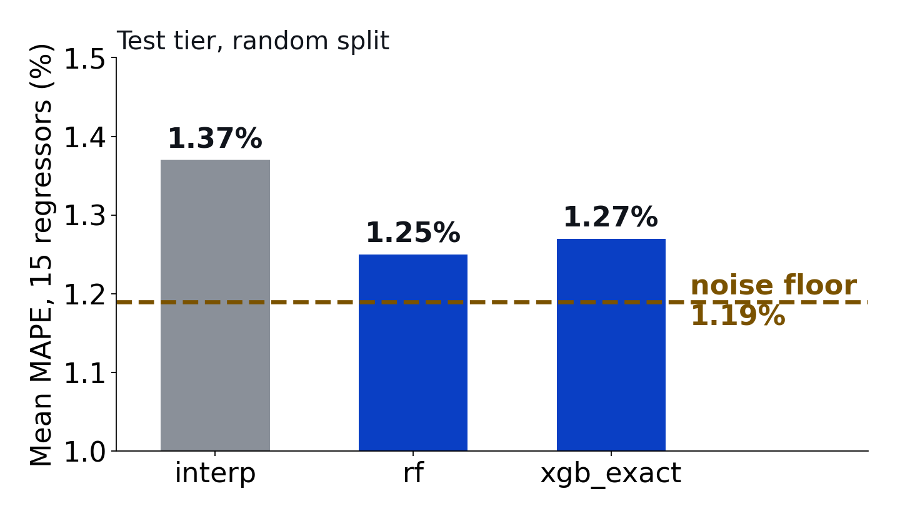

<!-- _class: lead -->
<!-- _paginate: false -->

# Profiling **Qwen3-30B-A3B** on AMD MI355X
## From the Frontier pipeline to Dataset B

What we found in the baseline, what we fixed, and what is still open.

<!--
Source for every claim: docs/profiling_project_summary.md (status per claim: Confirmed / Not verified / Contradicted).
-->

---

## The story in five steps

1. **Task:** collect data with the Frontier pipeline. Examine the regressor.
2. **Trust:** the trainer scores itself on its own training data.
3. **Data:** the plotted data did not make physical sense. We found 5 collection bugs.
4. **Result:** Dataset A gives a regressor at **1.25% mean error**.
5. **Scope:** Frontier's operator split comes from vLLM on NVIDIA. We must decide how to adapt it for SGLang on AMD.

<span class="tag prior">BASELINE</span> what Frontier gave us
<span class="tag ours">OUR WORK</span> what we found and changed

---

## Where each phase stands

| # | Phase | Headline |
|---|---|---|
| 1 | Starting point | Reported error is a training error |
| 2 | Data problems | 150 to 290 ms spikes in a 0.13 ms operator |
| 3 | Collection bugs | 5 root causes, 4 fixed in code |
| 4 | Silent kernel selection | RoPE timed a wrong computation |
| 5 | Model choice | Qwen3-30B-A3B |
| 6 | Host vs GPU time | Event timer measured host launch |
| 7 | Dataset A | 1.25% test MAPE, P95 2.5 to 4.0% |
| 8 | Dataset B | Collector works for TP1 eager |
| 9 | Operator mismatch | 6 of 9 operators fit SGLang on AMD |
| 10 | Decision | 5 open decisions (D1 to D5) |

---

<span class="tag prior">BASELINE</span>
## 1. Starting point: can we trust the regressor?

**Task:** collect data with the Frontier pipeline on MI355X. Examine the regressor.
**Question:** why a random forest (RF), and not another predictor?

```python
grid_search.fit(X, y)
score = grid_search.score(X, y)   # same data
logger.info(f"... error (MEAP) {-score}%")
```

<span class="small">`sklearn_execution_time_predictor.py` lines 2840 to 2841. A comment says: no train/test split.</span>

<!--
Status: task Confirmed (00_requirements_and_source_map.md, 88463bf). The motivation "why RF" is NOT VERIFIED in the code: no document records why RF was chosen (E2 evidence).
-->

---

## 1. Starting point: our move

<div class="cols">
<div class="box b">

### PITFALL
The reported error is a **training error**.
It says nothing about new inputs.
We cannot trust any reported result.

</div>
<div class="box a">

### OUR MOVE
Build a **regressor bench**.
Sealed split by token value: 75% train, 15% test, 10% hold-out.
Compare predictors on the same split.

</div>
</div>

Then we looked at the data itself.

---

<span class="tag prior">BASELINE</span>
## 2. The data did not make sense

<div class="cols">
<div>

- One timed run in 32 rows took **150 to 290 ms**. The other 49 runs took 0.13 ms.
- `attn_post_proj` and `attn_rope` medians **fell 17 to 37%** between 4k and 6k tokens, then rose.
- Curves were flat for thousands of tokens.

</div>
<div>

A GEMM cannot do this.

A replicate run on another node reproduced the same 32 rows. It was **not** a one-time stall.

<span class="small">story/STORY.md sections 3 to 5, jobs 21313 and 21334</span>

</div>
</div>

---

<!-- _class: tight -->

<span class="tag ours">OUR WORK</span>
## 3. Five collection bugs, five root causes

| Bug | Fix |
|---|---|
| CPython garbage collection stops the worker inside a timed scope | `gc.disable()` around the timed loop |
| Event pair measures **host launch span** when the GPU is idle | Time every shape twice. GPU-bound pass is the main column |
| Warm-up does not raise the GPU clock (648 to 948 MHz) | Per-row clock probe |
| `cuda._sleep` backlog slows next forwards by 2 to 8% | GEMM backlog + 8 settle forwards |
| ROCm adds a barrier every 1000 commands | `DEBUG_CLR_MAX_BATCH_SIZE=1000000` |

<span class="small">The barrier flag is **not** a default in the sbatch. The caller must pass it.</span>

<!-- Largest sample after the GC fix: 2.09 ms. -->

---

## 3. What the bugs did to the labels



Old data inflated the medians by **1.3 to 2.9x** (GEMM operators) and **4.3 to 12x** (`attn_rope`).

---

<span class="tag prior">BASELINE</span>
## 4. Silent kernel selection

Frontier can **exit with code 0** and measure the wrong operator.

<div class="cols">
<div class="box b">

### PITFALL
- **RoPE:** a forced torch fallback rotated 64 columns of head 0. 88 to 98% of elements stayed unchanged.
- **GPT-OSS attention:** sliding window and sinks are not modeled.
- **Failed job:** a `mkdir` error ended with exit code 0.

</div>
<div class="box a">

### OUR FIX
- Use the fused vLLM RoPE kernel. Record `attn_rope_impl` in each row. `sanity_check.py` rejects anything else.
- The sbatch now exits 1 if no CSV exists.
- GPT-OSS: **no fix**. The wrapper states the limit.

</div>
</div>

<!--
Contradicted in part: the narrative said GPT-OSS uses a different kernel. The AITER wrapper calls the same two entry points as SGLang (mha_batch_prefill_func, paged_attention_ragged). The mismatch is the attention VARIANT (sliding window, sinks).
-->

---

<span class="tag ours">OUR WORK</span>
## 5. Model choice: Qwen3-30B-A3B

- GPT-OSS needs sliding-window attention and sinks. Frontier cannot represent them.
- Qwen3-30B-A3B uses plain GQA attention. Its config has no sliding window.
- For attention, Frontier and SGLang use the **same two AITER entry points**.
- For RoPE and the KV cache write, they **differ** (phase 9).
- Scope: attention-layer operators. MoE operators are deferred.

<span class="tag tbd">NOT VERIFIED</span> <span class="small">No document records "kernels are similar" as the reason. The request file pre-selected the model.</span>

---

<span class="tag prior">BASELINE</span>
## 6. Host time or GPU time?

<div class="cols">
<div class="box b">

### PITFALL
The event timer measures the **host launch span** when the GPU is idle.

At 8 to 64 tokens, the event value is **3.2 to 6.9x** the traced `o_proj` kernel.

</div>
<div class="box a">

### OUR MOVE
Time every shape **twice**.
GPU-bound pass (device backlog) is the main column `time_stats`.
Legacy pass is kept as `time_stats_hostbound`.

</div>
</div>

With a backlog, the event median equals the traced kernel **plus 0.3 to 3.9 µs** on all 32 shapes.

---

## 6. We wrote the prediction before the run

Both hypotheses were registered in `08_measurement_validation_preregistration.md`.

<div class="big"><span class="n">262</span> <span class="o">/ 369</span></div>

numbers fall inside their predicted bands. 107 fall outside.

**Measurement contract** (`10_measurement_contract.md`): the label is **kernel-only device time at a stated clock**, plus a separate overhead term. Use the median.

<span class="small">Open: kernels below 10 µs have an instrument floor of ±3 to 5 µs.</span>

---

<span class="tag ours">OUR WORK</span>
## 7. Dataset A: what a regressor can learn

<div class="cols">
<div>



</div>
<div>

- 15 regressors, 13,308 rows
- Tree models: **P95 error 2.5 to 4.0%**
- Hold-out stays **sealed**

<span class="small">Block split (harder): mean P95 of `rf_frontier` is **9.04%**.</span>

</div>
</div>

<!--
"About 4% at P95": Confirmed with limits. 4% is the upper end of 2.5-4.0% (random split, test tier). P95 values were computed from test_predictions.csv in this work; they are not in a committed summary table.
-->

---

<span class="tag ours">OUR WORK</span>
## 8. Dataset B: operators inside a real server

<div class="cols">
<div class="box b">

### WHY
Dataset A never runs inside a server. Does an isolated measurement predict the real cost?

</div>
<div class="box a">

### WHAT WORKS
SGLang serves real requests. GPU kernel timestamps are mapped to operators.
TP1 eager pilot: **3659 of 3659** in-scope kernels resolve.

</div>
</div>

**Open:** 2150 kernels per run have no operator label. Graph replay is not solved. TP4 and the full sweep are not run.
**No Dataset A to Dataset B comparison exists yet.**

<span class="tag tbd">NOT VERIFIED</span> <span class="small">"Memory constraints": the launch plan has no memory-limit option.</span>

---

<span class="tag prior">BASELINE</span>
## 9. Frontier's operators are for vLLM on NVIDIA

Source reading of SGLang `v0.5.18` on the AMD image. No GPU job.

| Operator | Verdict |
|---|---|
| `attn_pre_proj`, `attn_post_proj` | Keep. Add a provider tag |
| `input_layernorm`, `post_attention_layernorm` | Keep (replace norm harness) |
| `attn_prefill`, `attn_decode` | Keep (replace decode harness) |
| `attn_rope` + `attn_kv_cache_save` | **Merge.** SGLang runs one fused kernel on HIP |
| `emb` | Unused by the simulator |

**6 keep, 2 merge, 1 unused.**

---

<span class="tag ours">OUR WORK</span>
## 10. Current decision and next step

**This is a recommendation, not a decision.** Five questions need the project owner:

1. **D1** SGLang flags (`SGLANG_USE_AITER`, attention backend, all-reduce fusion)
2. **D2** Accept the RoPE + KV-write merge
3. **D3** Include once-per-forward work (embedding, final norm, `lm_head`, sampler)
4. **D4** Recollect Dataset A under the serving provider, or keep it as a control
5. **D5** Page size 1 or 16

The Dataset B sweep waits for D1 to D5.

<!--
Contradicted in part: the narrative said "use only operators both agree on". The report recommends this for six operators; D1-D5 are open and scope_spec.json is provisional (qwen3-provisional-0.1) and includes more.
-->

---

## Open questions and risks

<div class="cols">
<div>

### Open
- D1 to D5 unanswered
- Canonical file: job 21486 or job 21539?
- TP1/TP2 decline of 0.9 to 1.3% per block: no cause
- Hold-out sealed: final error unmeasured

</div>
<div>

### Risks
- 3 Dataset A harness defects bias specific labels
- Validation tool still simulates nominal 1024 output tokens (real: 57 to 71)
- Production decode uses graphs. Attribution is not solved
- Barrier flag may differ from production

</div>
</div>

---

<!-- _class: tight -->

## Contribution map

| Phase | Pitfall in the baseline | Our fix | Result |
|---|---|---|---|
| 1 | Error scored on training data | Regressor bench, sealed splits | Honest error measured |
| 2 to 3 | Spikes, dips, host time in labels | 5 root causes fixed | Old medians were 1.3 to 12x too high |
| 4 | Wrong RoPE, silent exit 0 | Fused kernel, `attn_rope_impl`, exit 1 | Right operator timed |
| 6 | Event timer = host launch | Two-pass GPU-bound timing | Matches traced kernel +0.3 to 3.9 µs |
| 7 | No trustworthy accuracy | Bench on settle-8 file | 1.25% MAPE, P95 2.5 to 4.0% |
| 8 | Isolated only | In-situ collector | TP1 eager works |
| 9 | NVIDIA / vLLM operator split | Source study | 6 keep, 2 merge, 1 unused |
